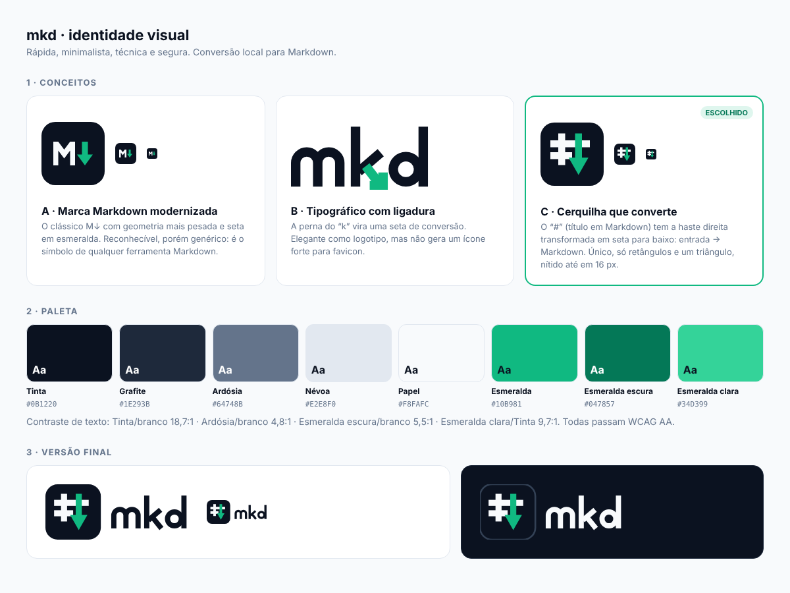

# mkd: arquivos para Markdown

Converte **PDF, Word (.docx), Google Docs (.docx/.odt), Excel (.xlsx), JSON, TXT e HTML** para Markdown.
Tudo roda no navegador: nenhum arquivo é enviado para servidores.

## Como funciona

- `src/converters/`: núcleo expansível, sem dependência de React. Cada formato é um `Converter` (veja `types.ts`) registrado em `index.ts`.
- `src/components/converter/`: upload, lista de arquivos, painel de opções e prévia.
- `src/routes/index.tsx`: página principal.
- `src/test/converters/`: testes (`bun run test`).

**Para adicionar um formato:** crie `src/converters/<formato>.ts` exportando um `Converter` e registre-o em `src/converters/index.ts`.
A interface (aceitar o arquivo, opções, prévia e download) se ajusta sozinha.

## Identidade visual



O ícone é uma cerquilha (`#`, título em Markdown) cuja haste direita vira uma seta para baixo, a ideia de conversão.

- Arquivos: `public/brand/logo.svg` (claro), `public/brand/logo-dark.svg` (escuro), `public/brand/icon.svg` e `public/favicon.svg`.
- Componente React: `src/components/brand/Logo.tsx` (`Logo`, `LogoIcon`, `LogoWordmark`).
- Paleta: Tinta `#0B1220`, Grafite `#1E293B`, Ardósia `#64748B`, Névoa `#E2E8F0`, Papel `#F8FAFC`, Esmeralda `#10B981` (ícone), Esmeralda escura `#047857` (ações no tema claro) e Esmeralda clara `#34D399` (ações no tema escuro). Os tokens estão em `src/styles.css` (`--brand`, `--brand-soft`).


This project was built with [Lovable](https://lovable.dev).

## Build with Lovable

Continue developing this project in the [Lovable editor](https://lovable.dev/projects/d3d7948a-367c-4703-96ca-c195d03c7174).

- **Ship faster**: describe what you want to build and Lovable handles the code.
- **Stay in sync**: every change made in Lovable is committed straight to this repository.
- **Full ownership**: this code is yours. Push to `main` on GitHub and your changes sync back into Lovable, ready for your next prompt.

## Development

Prefer working locally? You need Node.js and npm — [install with nvm](https://github.com/nvm-sh/nvm#installing-and-updating).

```sh
git clone <this-repository-url>
cd <repository-name>
npm i
npm run dev
```
