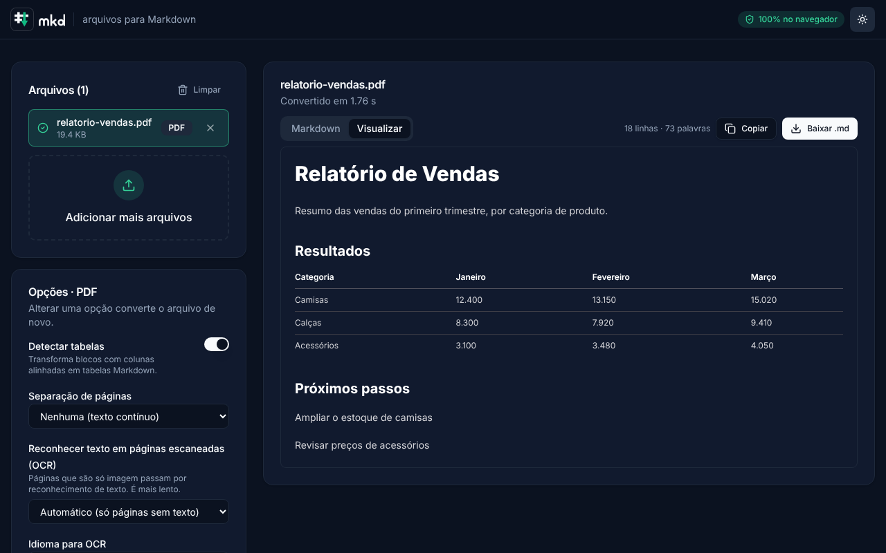
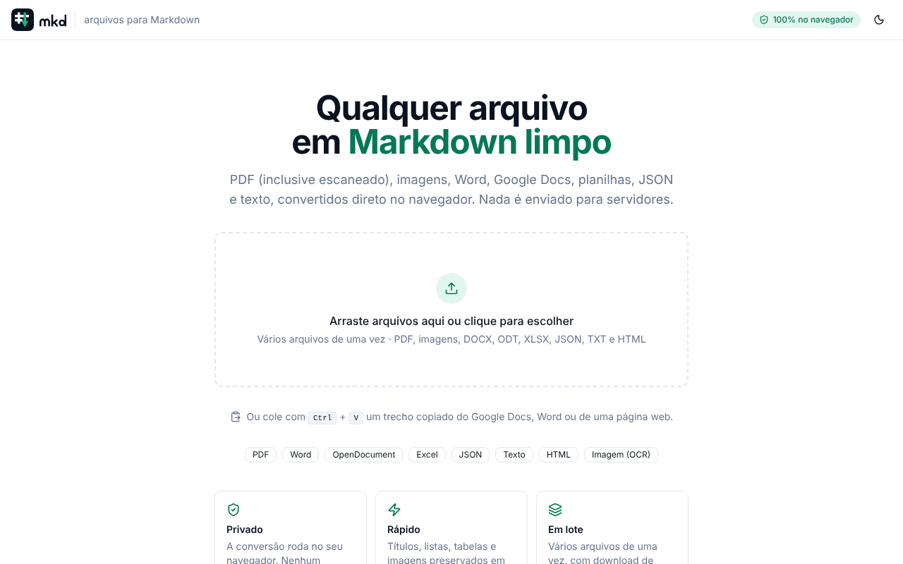
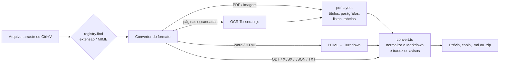

<div align="center">

<picture>
  <source media="(prefers-color-scheme: dark)" srcset="public/brand/logo-dark.svg">
  
</picture>

### Arquivos para Markdown, direto no navegador

Converte PDF (inclusive escaneado), imagens, Word, Google Docs, Excel, JSON, TXT e HTML em Markdown limpo.<br>
**Nenhum arquivo é enviado para servidores.**

[**Abrir o app →**](https://mkd-convert.lovable.app)



</div>

---

## Sumário

- [Por que o mkd](#por-que-o-mkd)
- [Funcionalidades](#funcionalidades)
- [Formatos suportados](#formatos-suportados)
- [Como usar](#como-usar)
- [Limitações conhecidas](#limitações-conhecidas)
- [Desenvolvimento](#desenvolvimento)
- [Arquitetura](#arquitetura)
- [Como adicionar um formato](#como-adicionar-um-formato)
- [OCR](#ocr)
- [Testes](#testes)
- [Stack](#stack)
- [Identidade visual](#identidade-visual)
- [Edição pelo Lovable](#edição-pelo-lovable)

## Por que o mkd

- **Privado:** a conversão inteira roda no seu navegador. Documentos sigilosos (contratos, leis em tramitação, planilhas internas) nunca saem do seu computador. Nem o reconhecimento de texto (OCR) usa serviços externos.
- **Estrutura preservada:** títulos, listas, tabelas, negrito, itálico, links e imagens viram Markdown de verdade, não um bloco de texto corrido.
- **Para fluxos com IA e documentação:** Markdown é o formato ideal para colar em ferramentas de IA, wikis, READMEs e sistemas de documentação.

## Funcionalidades

|                                   |                                                                                                                     |
| --------------------------------- | ------------------------------------------------------------------------------------------------------------------- |
| 📂 **Vários arquivos de uma vez** | Arraste para qualquer lugar da página ou clique para escolher. A conversão roda em fila.                            |
| 📋 **Colar com Ctrl+V**           | Cole um trecho copiado do Google Docs, do Word ou de uma página web e receba o Markdown na hora.                    |
| 👀 **Prévia**                     | Veja o Markdown bruto ou renderizado antes de baixar.                                                               |
| ⬇️ **Download**                   | `.md` por arquivo, ou `.zip` com tudo (e com as imagens extraídas em uma pasta).                                    |
| 🔍 **OCR**                        | Imagens e PDFs escaneados viram texto, em português ou inglês.                                                      |
| ⚙️ **Opções por formato**         | Ex.: detecção de tabelas, separação de páginas, limite de linhas da planilha. Mudar uma opção reconverte o arquivo. |
| 📈 **Arquivos grandes**           | Progresso por página, cancelamento ao remover o arquivo e opção de converter só as primeiras páginas.               |
| 🔤 **Acentuação correta**         | Arquivos em ANSI (Windows-1252) e PDFs com acentos separados da letra saem com `ç`, `ã` e `é` corretos.             |
| 🇧🇷 **Mensagens em português**     | Avisos e erros explicam o que aconteceu e o que fazer.                                                              |
| 🌗 **Tema claro e escuro**        | E layout que funciona no celular.                                                                                   |

## Formatos suportados

| Formato           | Extensões                                           | O que é preservado                                                                                                                                                                                                                                       | Opções                                                                                                                                                      |
| ----------------- | --------------------------------------------------- | -------------------------------------------------------------------------------------------------------------------------------------------------------------------------------------------------------------------------------------------------------- | ----------------------------------------------------------------------------------------------------------------------------------------------------------- |
| **PDF**           | `.pdf`                                              | Títulos (pelo tamanho da fonte), parágrafos, listas, tabelas, hifenização desfeita, acentos desenhados separados da letra (ex.: `c¸ ˜ao` → `ção`), acentos gravados em codificação trocada (ex.: `MUNICÕPIO` → `MUNICÍPIO`) e carimbos girados na margem | Detectar tabelas · Separação de páginas · OCR automático · Idioma do OCR · Páginas a converter (todas, primeiras N ou personalizado: `3-7`, `1-3, 5`, `8-`) |
| **PDF escaneado** | `.pdf`                                              | Igual ao PDF, via OCR. Detecta páginas que são imagem mesmo com carimbos de texto por cima                                                                                                                                                               | (mesmas do PDF)                                                                                                                                             |
| **Imagem**        | `.png` `.jpg` `.jpeg` `.webp` `.bmp` `.gif` `.avif` | Texto por OCR com títulos, parágrafos e tabelas. Corrige a rotação de fotos do celular                                                                                                                                                                   | Idioma do texto · Detectar tabelas                                                                                                                          |
| **Word**          | `.docx` `.docm` `.dotx`                             | Títulos, negrito, itálico, listas, tabelas, links e imagens                                                                                                                                                                                              | Extrair imagens                                                                                                                                             |
| **Google Docs**   | via `.docx` ou `.odt`                               | Igual ao Word. No Google Docs: _Arquivo → Fazer download_                                                                                                                                                                                                | —                                                                                                                                                           |
| **OpenDocument**  | `.odt` `.ott`                                       | Títulos, estilos, listas, tabelas, links e imagens                                                                                                                                                                                                       | Extrair imagens                                                                                                                                             |
| **Excel**         | `.xlsx` `.xlsm`                                     | Uma tabela Markdown por aba                                                                                                                                                                                                                              | Primeira linha é cabeçalho · Limite de linhas por aba                                                                                                       |
| **JSON**          | `.json` `.jsonl` `.ndjson` `.geojson`               | Objetos viram seções; listas de objetos viram tabelas. Detecta arquivos em ANSI                                                                                                                                                                          | Estruturado ou bloco de código                                                                                                                              |
| **Texto**         | `.txt` `.md` `.markdown` `.text` `.log`             | Conteúdo original, com detecção de codificação (UTF-8, UTF-16 ou Windows-1252/ANSI)                                                                                                                                                                      | Envolver em bloco de código                                                                                                                                 |
| **HTML**          | `.html` `.htm` `.xhtml`                             | Estrutura da página, inclusive conteúdo colado do Google Docs. Respeita o `charset` declarado                                                                                                                                                            | —                                                                                                                                                           |

## Como usar

1. Abra **[mkd-convert.lovable.app](https://mkd-convert.lovable.app)**.
2. Arraste os arquivos para a página, clique na área de upload ou cole um conteúdo com **Ctrl+V**.
3. Selecione um arquivo na lista para ver a prévia (abas **Markdown** e **Visualizar**) e ajustar as opções.
4. Clique em **Copiar**, **Baixar .md** ou **Baixar todos em .zip**.



> [!TIP]
> Para um documento inteiro do Google Docs, use _Arquivo → Fazer download → Microsoft Word (.docx)_. Para um trecho, basta copiar e colar no mkd.

## Limitações conhecidas

- **OCR** não reconhece texto manuscrito. Fotos tortas, borradas ou escuras dão resultado pior; o app avisa quando a confiança fica baixa. Revise números e símbolos (ex.: `§`), que são os erros mais comuns.
- **PDF:** o formato guarda texto posicionado, não a estrutura. Títulos e tabelas são deduzidos pelo layout; células com várias linhas e tabelas sem espaço entre colunas podem não ser detectadas. Marcadores de lista desenhados como imagem não viram `- item`.
- **Formatos antigos** `.doc` e `.xls` não são suportados: abra no Word/Excel e salve como `.docx`/`.xlsx`.
- **Arquivos protegidos por senha** precisam ter a senha removida antes.
- **Memória:** tudo roda no navegador, então arquivos muito grandes dependem da memória do aparelho. Para PDFs enormes, use a opção _Páginas a converter_.

## Desenvolvimento

**Pré-requisitos:** [Bun](https://bun.sh) (o projeto usa `bun.lock`) ou Node.js 20.19+ / 22.12+.

```bash
git clone https://github.com/jvieira11/blank-canvas.git
cd blank-canvas
bun install
bun run dev        # http://localhost:8080
```

| Comando             | O que faz                                                   |
| ------------------- | ----------------------------------------------------------- |
| `bun run dev`       | Servidor de desenvolvimento                                 |
| `bun run build`     | Build de produção (Cloudflare Workers, via nitro)           |
| `bun run test`      | Testes (Vitest)                                             |
| `bun run lint`      | ESLint + Prettier                                           |
| `bun run format`    | Formata o código com Prettier                               |
| `bun run ocr:langs` | Atualiza os modelos de idioma do OCR em `public/tesseract/` |

## Arquitetura

O núcleo de conversão (`src/converters/`) não depende de React: cada formato é um **plugin** que segue o mesmo contrato. A interface lê esse contrato e se monta sozinha (tipos aceitos, opções, prévia e download).



### Estrutura de pastas

```
src/
├── converters/              ← núcleo de conversão (sem React)
│   ├── types.ts             ← contrato Converter
│   ├── registry.ts          ← registro e detecção por extensão/MIME
│   ├── index.ts             ← lista de conversores ativos
│   ├── convert.ts           ← executa o conversor + pós-processamento comum
│   ├── pdf.ts               ← PDF (texto + OCR de páginas escaneadas)
│   ├── pdf-layout.ts        ← reconstrói a estrutura a partir de texto posicionado
│   ├── pdf-images.ts        ← mede a área coberta por imagens (detecção de escaneados)
│   ├── image.ts             ← imagens via OCR
│   ├── docx.ts · odt.ts · xlsx.ts · json.ts · text.ts · html.ts
├── lib/
│   ├── ocr.ts               ← motor de OCR (Tesseract.js) e conversão do resultado
│   ├── html-to-markdown.ts  ← Turndown configurado (tabelas, listas, riscado)
│   ├── markdown.ts          ← normalização e tabelas GFM
│   ├── messages.ts          ← avisos e erros em português
│   └── download.ts          ← .md e .zip
├── hooks/
│   ├── use-conversions.ts   ← fila, progresso e cancelamento
│   ├── use-global-file-input.ts ← arrastar na página e colar (Ctrl+V)
│   └── use-theme.ts
├── components/
│   ├── converter/           ← DropZone, FileList, OptionsPanel, MarkdownPreview
│   ├── brand/Logo.tsx
│   └── ui/                  ← shadcn/ui
├── routes/index.tsx         ← página principal
└── test/converters/         ← testes dos conversores
public/
├── brand/                   ← logotipos em SVG
└── tesseract/               ← modelos de idioma do OCR (por, eng)
```

### O contrato `Converter`

```ts
interface Converter {
  id: string; // "docx"
  label: string; // nome exibido: "Word"
  extensions: string[]; // [".docx"]
  mimeTypes: string[];
  options?: ConverterOption[]; // a interface renderiza sozinha (boolean ou select)
  convert(file: Blob, context: ConversionContext): Promise<ConversionResult>;
}

interface ConversionContext {
  options: ConverterOptionValues;
  assetDir: string; // pasta das imagens extraídas
  onProgress: (p: ConversionProgress) => void;
  signal: AbortSignal; // cancelado quando o usuário remove o arquivo
}

interface ConversionResult {
  markdown: string;
  assets: ConversionAsset[]; // imagens extraídas
  warnings: string[]; // traduzidos e agrupados em convert.ts
}
```

As bibliotecas pesadas (pdf.js, mammoth, Tesseract…) são carregadas com `import()` só quando um arquivo daquele tipo é aberto, então a página inicial continua leve.

## Como adicionar um formato

1. Crie `src/converters/csv.ts`:

   ```ts
   import type { Converter } from "./types";
   import { toMarkdownTable } from "@/lib/markdown";

   export const csvConverter: Converter = {
     id: "csv",
     label: "CSV",
     extensions: [".csv"],
     mimeTypes: ["text/csv"],
     options: [
       { type: "boolean", key: "header", label: "Primeira linha é cabeçalho", default: true },
     ],
     async convert(file, { options }) {
       const rows = (await file.text())
         .trim()
         .split(/\r?\n/)
         .map((line) => line.split(","));
       return {
         markdown: toMarkdownTable(rows, Boolean(options["header"])),
         assets: [],
         warnings: [],
       };
     },
   };
   ```

2. Registre em `src/converters/index.ts`: `.register(csvConverter)`.
3. Adicione um teste em `src/test/converters/`.

Pronto: o app passa a aceitar o formato, mostrar o selo, renderizar as opções e oferecer prévia e download.

## OCR

- Usa [Tesseract.js](https://github.com/naptha/tesseract.js) em WebAssembly, dentro de um Web Worker.
- **Sem CDN externa:** o núcleo WebAssembly sai do `node_modules` no build e os modelos de idioma (`por`, `eng`, versão _best_int_) ficam em `public/tesseract/`. Tudo só é baixado na primeira vez que o OCR é usado.
- O texto reconhecido é convertido para o mesmo formato do pdf.js, então passa pelo mesmo motor de layout (`pdf-layout.ts`) e ganha títulos, parágrafos e tabelas.
- Filtros contra ruído: palavras e linhas com confiança muito abaixo do resto da página (brasões, assinaturas) e acentos de títulos grandes lidos como linha própria.
- Em PDFs, uma página é tratada como escaneada quando tem quase nenhum texto ou quando uma imagem cobre pelo menos metade dela.

> [!NOTE]
> O Tesseract.js 7 tem dois defeitos contornados em `src/lib/ocr.ts`: dados de idioma passados diretamente ao `createWorker` não funcionam (por isso o `langPath`), e erros dentro do worker nem sempre rejeitam a promessa (por isso o `errorHandler` com tempo limite).

## Testes

```bash
bun run test
```

Cobrem o registro de formatos, cada conversor (DOCX, ODT e XLSX são gerados em memória nos próprios testes), o motor de layout do PDF (títulos, parágrafos, listas, tabelas, texto justificado, entrelinha larga), a conversão do resultado do OCR, a detecção de páginas escaneadas, as mensagens em português e o contrato de progresso e cancelamento.

## Stack

| Camada      | Tecnologia                                                                                                      |
| ----------- | --------------------------------------------------------------------------------------------------------------- |
| Framework   | [TanStack Start](https://tanstack.com/start) · React 19 · TypeScript 5.9 · Vite 8                               |
| Estilo      | Tailwind CSS 4 · [shadcn/ui](https://ui.shadcn.com) · Lucide                                                    |
| PDF         | [pdf.js](https://mozilla.github.io/pdf.js/) 6                                                                   |
| Word / HTML | [mammoth](https://github.com/mwilliamson/mammoth.js) · [Turndown](https://github.com/mixmark-io/turndown) + GFM |
| Planilhas   | [read-excel-file](https://gitlab.com/catamphetamine/read-excel-file)                                            |
| OCR         | [Tesseract.js](https://github.com/naptha/tesseract.js) 7                                                        |
| ZIP         | [JSZip](https://stuk.github.io/jszip/)                                                                          |
| Prévia      | react-markdown + remark-gfm                                                                                     |
| Testes      | Vitest + jsdom                                                                                                  |
| Hospedagem  | [Lovable](https://lovable.dev) (Cloudflare Workers)                                                             |

## Identidade visual


O ícone é uma cerquilha (`#`, título em Markdown) cuja haste direita vira uma seta para baixo: a conversão.

| Cor              | HEX       | Uso                                 |
| ---------------- | --------- | ----------------------------------- |
| Tinta            | `#0B1220` | Texto, ícone e fundo do tema escuro |
| Grafite          | `#1E293B` | Superfícies e bordas no tema escuro |
| Ardósia          | `#64748B` | Texto secundário                    |
| Névoa            | `#E2E8F0` | Bordas no tema claro                |
| Papel            | `#F8FAFC` | Fundos claros                       |
| Esmeralda        | `#10B981` | Seta do ícone                       |
| Esmeralda escura | `#047857` | Destaques e ações no tema claro     |
| Esmeralda clara  | `#34D399` | Destaques e ações no tema escuro    |

- Arquivos: `public/brand/logo.svg`, `public/brand/logo-dark.svg`, `public/brand/icon.svg` e `public/favicon.svg`.
- Componente React: `src/components/brand/Logo.tsx`. Tokens de cor em `src/styles.css` (`--brand`, `--brand-soft`).

## Edição pelo Lovable

Este repositório está conectado ao [projeto no Lovable](https://lovable.dev/projects/d3d7948a-367c-4703-96ca-c195d03c7174):

- Commits no `main` aparecem no editor do Lovable, e edições feitas no Lovable viram commits aqui.
- Mudanças enviadas pelo GitHub não consomem créditos do Lovable; só as mensagens ao agente do Lovable consomem.
- **Não use `git push --force`** nem reescreva commits já enviados: o Lovable perderia o histórico do projeto. Veja também o `AGENTS.md`.
